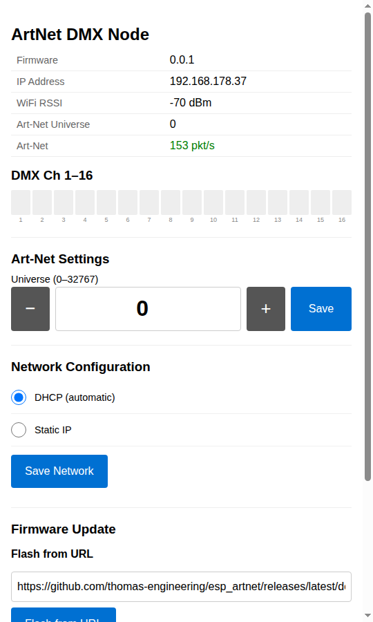
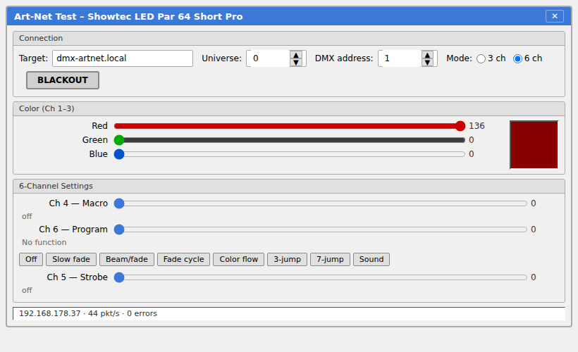

# ESP ArtNet — Art-Net to DMX Node

[](LICENSE)
[](https://claude.ai)

An ESP32-S3 firmware that receives Art-Net (UDP) packets over WiFi and
forwards them as DMX-512 to a lighting fixture.

---

## Hardware

### Board

**Freenove ESP32-S3-WROOM** — the onboard camera module stays connected but
is not used by this firmware.

### Wiring

| ESP32-S3 GPIO | MAX3485 pin | Function |
|---|---|---|
| GPIO 43 (UART0 TX) | DI (pin 4) | DMX data out |
| GPIO 44 (UART0 RX) | RO (pin 1) | Reserved (not used) |
| GPIO 1 | DE + RE (pins 2+3, tied) | Direction control — HIGH = transmit |
| GND | GND (pin 5) | Common ground |
| 3.3 V or 5 V | VCC (pin 8) | Supply |

The MAX3485 A/B outputs connect to the XLR-3 or XLR-5 DMX connector:
- Pin 2 → MAX3485 A (non-inverting)
- Pin 3 → MAX3485 B (inverting)
- Pin 1 → ground shield

See `doc/pinout.jpg` for the board layout.

### Reset / factory reset button

GPIO 0 is the onboard **BOOT** button.
Hold it for **3 seconds** (at any time, not only at power-on) to clear stored
WiFi credentials and re-enter provisioning mode.

---

## Firmware

### Prerequisites

- **ESP-IDF v6.1** (Xtensa toolchain, not CMake system-wide)
- Python 3 (for `idf.py`)
- Linux / macOS host (Windows WSL works too)

### Environment setup

```bash
export IDF_PATH=$HOME/.espressif/v6.1/esp-idf
export PATH="$HOME/.espressif/tools/xtensa-esp-elf/esp-15.2.0_20251204/xtensa-esp-elf/bin:$PATH"
source "$IDF_PATH/export.sh"
```

### Build

```bash
cd esp_artnet
idf.py build
```

The first build downloads the `espressif/mdns` managed component automatically.

### Flash

Connect the board via USB (port `/dev/ttyACM0` on Linux — the onboard
USB-JTAG bridge, USB VID:PID 303a:1001):

```bash
idf.py -p /dev/ttyACM0 flash
```

> **Note:** `idf.py monitor` hangs on this USB-JTAG device because the kernel
> rejects DTR/RTS modem-control ioctls with EPROTO.  Use a custom
> `reset_capture.py` script (see the session scratchpad) or any plain serial
> terminal at 115200 baud to read boot output.

### Partition table

The firmware uses a custom OTA partition table (`partitions.csv`) with two
app slots and a 8 MB flash.  OTA rollback is enabled — if the new image does
not confirm itself the bootloader automatically reverts to the previous slot.

---

## Provisioning (first-time WiFi setup)

On first boot (or after a factory reset) the device starts a **SoftAP captive
portal**:

1. The device broadcasts an open WiFi network named **`ARTNET_<MAC>`**.
2. Connect to it with a phone or laptop — the captive-portal page opens
   automatically (iOS, Android, and most desktop OSes detect it).
   If it does not open automatically, navigate to **http://192.168.4.1**.
3. Click **Scan networks** to populate the dropdown with nearby SSIDs.
4. Select your network, enter its password, and tap **Connect**.
5. The device restarts, connects to your network, and is reachable at
   **http://dmx-artnet.local** (mDNS) or at the IP shown in your router's
   DHCP table (hostname: `dmx-artnet`).

**To re-provision:** hold the BOOT button for 3 s at power-on.  The stored
credentials are erased and the device returns to SoftAP mode.

---

## Web Interface

Once connected, the node serves a status and configuration page at
**http://dmx-artnet.local/** (or the device's IP address).



### Status

The top of the page auto-refreshes every 2 seconds and shows firmware
version, IP address, WiFi RSSI, active Art-Net universe, incoming packet
rate, and a live bar graph for DMX channels 1–16.

### Art-Net Settings

A large numeric input with **−** / **+** buttons lets you change the
Art-Net universe at runtime (0–32767).  Pressing **Save** applies the
change immediately — no reboot required.

### Network Configuration

Choose between **DHCP (automatic)** and **Static IP**.  Selecting Static IP
reveals input fields for IPv4 address, netmask, gateway and DNS server.
Saving network settings restarts the device to apply them.

### Firmware Update

| Method | Description |
|---|---|
| **Flash from URL** | Enter an HTTPS URL to a `.bin` file (pre-filled with the latest GitHub release URL) and press **Flash from URL**. |
| **Upload binary** | Select a local `.bin` file and press **Upload & flash**. |

The device downloads/receives the image, verifies it, writes it to the
inactive OTA slot, sets it as boot target, and restarts — all over HTTP.

---

## Operation

Once connected to your WiFi network the node listens for **Art-Net ArtDMX**
packets on **UDP port 6454**.  The universe is configured on the provisioning
page (default 0 — the first Art-Net universe).  Received channel data is
forwarded as DMX-512 at ~40 Hz on the RS-485 output.

### Status LEDs

The board has two onboard LEDs that indicate the current state:

| State | WS2812 RGB (GPIO 48) | Plain LED (GPIO 2) |
|---|---|---|
| Provisioning — SoftAP active | Blue, 1 Hz blink | Blinks with it |
| Connecting to WiFi | Yellow, 5 Hz blink | Blinks with it |
| Connected — Art-Net packets arriving | Green, solid | Off |
| Connected — no Art-Net data for > 3 s | Amber, solid | Off |

### OTA updates

Firmware can be updated in two ways:

**Automatic** — every 6 hours the firmware checks the GitHub release page of
`thomas-engineering/esp_artnet` for a newer binary.  If a new release is
found it downloads and verifies the image over HTTPS and reboots into the new
slot.

**Manual** — use the **Firmware Update** section of the web interface to
flash a binary from a URL or upload one from disk (see [Web Interface](#web-interface)).

---

## Python test client

A minimal tkinter GUI is provided in `python_test_client/` to send Art-Net directly
to the node.  It is designed around the **Showtec LED Par 64 Short Pro RGB
(order 42427)** — see `doc/42427_Anleitung 42427 Englisch.pdf` for the full
lamp manual.



### Requirements

- Python 3.10 or newer
- tkinter (usually bundled; on Ubuntu/Debian: `sudo apt install python3-tk`)
- No third-party packages

### Launch

```bash
cd python_test_client
python3 gui.py
```

### GUI overview

| Section | Controls |
|---|---|
| **Connection** | Target hostname or IP (`dmx-artnet.local`), Art-Net universe (0–32767), DMX start address (1–507), 3 ch / 6 ch mode, **BLACKOUT** toggle |
| **Color** | Red / Green / Blue sliders (Ch 1–3) + live color preview swatch |
| **6-Channel Settings** | Ch 4 macro, Ch 6 program with one-click preset buttons, Ch 5 strobe/speed/sensitivity (label changes with Ch 6 value) |
| **Status bar** | Resolved IP, packets per second, error count |

The background thread sends at **44 Hz** continuously — no explicit "Send"
button is needed; every slider change takes effect within one frame.

### Lamp DMX mapping (42427)

#### 3-channel mode

| Channel | Parameter |
|---|---|
| Ch 1 | Red 0–255 |
| Ch 2 | Green 0–255 |
| Ch 3 | Blue 0–255 |

#### 6-channel mode

| Channel | Parameter | Range |
|---|---|---|
| Ch 1 | Red | 0–255 |
| Ch 2 | Green | 0–255 |
| Ch 3 | Blue | 0–255 |
| Ch 4 | Macro colors | 0–7 off, 8–255 (36 macros) |
| Ch 5 | Strobe / Speed / Sensitivity | depends on Ch 6 |
| Ch 6 | Built-in program | 0–31 off, 32–63 fade, 64–95 beam/fade, 96–127 fade cycle, 128–159 color flow, 160–191 3-jump, 192–223 7-jump, 224–255 sound |

Ch 5 role changes with Ch 6:
- Ch 6 = 0–31 → Ch 5 is **Strobe** (0–15 off, 16–255 strobe slow→fast)
- Ch 6 = 32–223 → Ch 5 is **Speed** (effect speed slow→fast)
- Ch 6 = 224–255 → Ch 5 is **Sensitivity** (sound sensitivity low→high)

The GUI updates the Ch 5 label automatically as you move the Ch 6 slider.

---

## Protocol byte-order reference

### Art-Net ArtDMX packet

Art-Net is defined in the [Art-Net 4 specification](https://artisticlicence.com/WebSiteMaster/User%20Guides/art-net.pdf).
Multi-byte fields use **mixed endianness** — read each field's note carefully.

```
Offset  Len  Endian   Field          Value / Notes
------  ---  -------  -------------  ------------------------------------------
     0    8   —       ID             ASCII "Art-Net\0"  (literal, no byte order)
     8    2   LE      OpCode         0x5000 for ArtDMX → bytes: 0x00 0x50
    10    2   BE      ProtVer        14     → bytes: 0x00 0x0E
    12    1   —       Sequence       0–255, wraps; 0 = disable ordering check
    13    1   —       Physical       source port hint (informational)
    14    1   —       SubUni         low 8 bits of the 15-bit universe
    15    1   —       Net            high 7 bits of the 15-bit universe
    16    2   BE      Length         number of DMX channels (2–512, must be even)
    18  ≤512  —       Data           DMX channel values (Ch 1 at offset 18)
```

**Common mistake:** OpCode `0x5000` looks like it should be packed as `0x50 0x00`,
but because it is little-endian, `struct.pack('<H', 0x5000)` correctly produces
`0x00 0x50`.  Accidentally using `0x0050` as the constant produces the wrong
wire bytes `0x50 0x00` and receivers will silently discard the packet.

#### Python example — build a minimal ArtDMX packet

```python
import struct

ID       = b'Art-Net\x00'
OP_DMX   = 0x5000          # logical value; LE packing makes it 0x00 0x50 on the wire
PROT_VER = 14
universe = 0               # 15-bit port address (0–32767)
channels = bytearray(512)  # DMX data, index 0 = Ch 1

sub_uni = universe & 0xFF
net     = (universe >> 8) & 0x7F
length  = len(channels)    # must be even, 2–512

packet = (
    ID
    + struct.pack('<H', OP_DMX)        # LE  → 0x00 0x50
    + struct.pack('>H', PROT_VER)      # BE  → 0x00 0x0E
    + bytes([0, 0])                    # sequence=0, physical=0
    + bytes([sub_uni, net])            # low byte first, then high byte
    + struct.pack('>H', length)        # BE  → 0x02 0x00  (for 512 channels)
    + bytes(channels)
)
```

#### C example — verify the opcode in a received packet

```c
/* ArtDMX opcode check in a packed struct (little-endian host) */
#define ARTNET_OP_DMX  0x5000u   /* logical value */

typedef struct __attribute__((packed)) {
    uint8_t  id[8];      /* "Art-Net\0" */
    uint16_t opcode;     /* stored LE on wire → reads as 0x5000 on LE CPU */
    uint16_t prot_ver;   /* stored BE on wire → needs ntohs() */
    uint8_t  sequence;
    uint8_t  physical;
    uint8_t  sub_uni;    /* low  8 bits of universe */
    uint8_t  net;        /* high 7 bits of universe */
    uint16_t length;     /* stored BE on wire → needs ntohs() */
    uint8_t  data[512];
} artnet_dmx_t;

/* Reconstruct the 15-bit universe */
uint16_t universe = pkt.sub_uni | ((uint16_t)pkt.net << 8);

/* Convert length from big-endian */
uint16_t data_len = ntohs(pkt.length);
```

---

### DMX-512

DMX-512 is a **serial** protocol; there are no multi-byte integer fields.
Each channel is a single unsigned byte (0–255).  Byte order is not applicable.

```
Bit rate:  250 000 baud
Frame:     1 start bit, 8 data bits, 2 stop bits  (8N2)

A DMX frame starts with a BREAK — a low level held for ≥ 88 µs —
followed by a MARK AFTER BREAK (MAB, ≥ 8 µs high), then:

  Byte 0:  Start Code   (0x00 for standard dimmer / color data)
  Byte 1:  Channel 1 value  (0–255)
  Byte 2:  Channel 2 value
  …
  Byte 512: Channel 512 value  (up to 512 channels per frame)
```

**Mapping from Art-Net to DMX:**
The Art-Net `Data` array is zero-indexed (`data[0]` = Ch 1).
DMX channel *N* (1-based) maps to `data[N-1]`.
The firmware forwards the full 512-byte array unchanged as the DMX payload,
using the Art-Net DMX start address selected in the Python GUI.

---

## Project structure

```
esp_artnet/
├── main/
│   ├── main.c           — app entry point, mDNS init, task creation
│   ├── provisioning.c   — SoftAP captive portal, WiFi connect, DNS hijack,
│   │                       NVS-backed universe + network config (DHCP/static IP)
│   ├── artnet.c         — UDP receiver, Art-Net parser, runtime universe change
│   ├── dmx.c            — UART0 DMX-512 transmitter
│   ├── ota.c            — automatic GitHub OTA updater (6 h interval)
│   ├── webserver.c      — status/config web UI, /api/status, /api/config,
│   │                       /ota/url, /ota/upload
│   ├── led.c/.h         — WS2812 + GPIO2 status LEDs
│   ├── CMakeLists.txt
│   └── idf_component.yml  — managed components: espressif/cjson, mdns, led_strip
├── python_test_client/
│   ├── artnet.py        — Art-Net UDP sender (stdlib only)
│   ├── gui.py           — tkinter GUI for Showtec LED Par 64 (42427)
│   └── requirements.txt
├── doc/
│   ├── screenshot_webui.png
│   ├── screenshot_gui.png
│   ├── pinout.jpg
│   └── 42427_Anleitung 42427 Englisch.pdf
├── .github/workflows/
│   └── build-release.yml  — builds firmware with ESP-IDF v6.1 and publishes
│                             a GitHub release with the binary
├── partitions.csv
└── sdkconfig.defaults
```

---

## Development

This project was coded with [Claude](https://claude.ai) (Anthropic AI) acting as the primary programmer.
